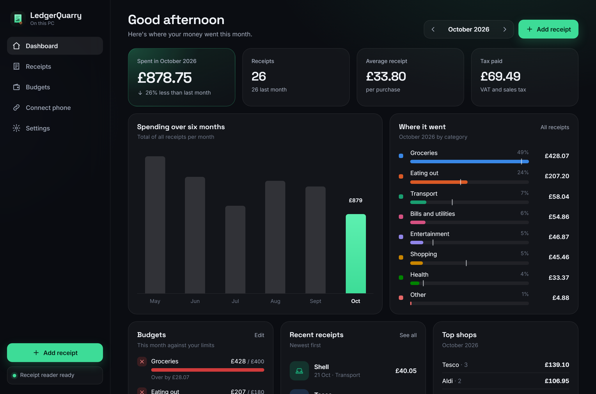
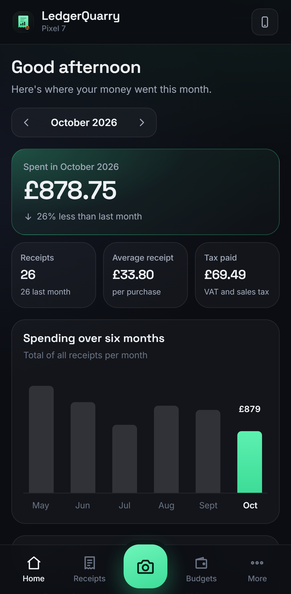
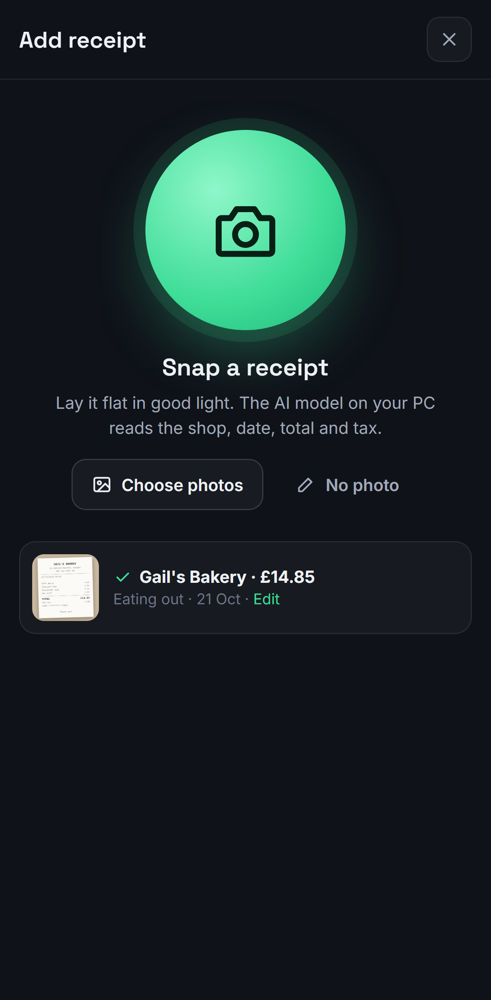
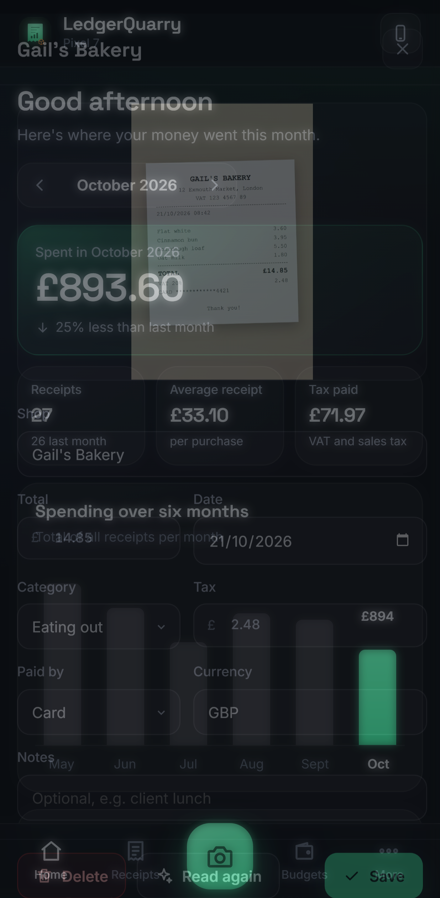

# LedgerQuarry

**Snap a receipt on your phone. A local AI model reads it. Your spending shows up on your PC.** Nothing goes to a cloud service: the phone talks to your PC privately over Tailscale, and the receipt is read by Ollama running on your own machine.



| Phone: dashboard | Phone: snap and read | Phone: receipt |
|---|---|---|
|  |  |  |

## What it does

- **Desktop dashboard** for Windows: this month's spending against last month, a six-month trend, spending by category, budgets with on-track / close / over status, top shops, recent receipts, tax paid.
- **Phone app** you install from the PC with a QR code: a big camera button, your receipts, budgets, and an offline queue so photos taken with no signal upload later. Works on Android and iPhone (it's a web app added to the home screen, no app store).
- **Receipt reading** by a local vision model ([Ollama](https://repoquarry.dev/projects/ollama) with Qwen2.5-VL 7B by default, or Jan, LM Studio or any OpenAI-compatible server). It fills in shop, date, total, tax, currency, category, payment method and line items. Anything it can't read is flagged for a quick check instead of guessed.
- **Private connection** with [Tailscale](https://tailscale.com): the app listens on `127.0.0.1` and on your tailnet address only, and can publish itself on your tailnet as `https://<your-pc>.ts.net` with one click. It is never exposed to your local network or the internet.
- **Your data stays a file on your PC**: one SQLite database plus the photos, in `%APPDATA%\dev.repoquarry.ledgerquarry`. Export everything as CSV for a spreadsheet or your accountant.

## Get started

1. **Install LedgerQuarry** from [Releases](https://github.com/Obiwayne/LedgerQuarry/releases): `LedgerQuarry_x.y.z_x64-setup.exe` (per-user, no admin needed) or the MSI. It is not code-signed yet, so SmartScreen may ask: choose **More info → Run anyway**.
2. **Turn on receipt reading** (Settings): install [Ollama](https://ollama.com/download), then press **Download qwen2.5vl:7b** in LedgerQuarry (about 6 GB, once). Runs best with 8 GB+ of graphics memory; works on a CPU, slower. Prefer Jan or LM Studio? Pick **Another AI app** and enter its address and vision model.
3. **Connect your phone** (Connect phone):
   - Install Tailscale on the PC and the phone and sign in to the same account on both.
   - Press **Turn on private HTTPS link** (Tailscale may ask you once to enable HTTPS for your tailnet).
   - Press **Show pairing code** and scan it with the phone's camera. The phone pairs itself.
   - Add it to the home screen: iPhone **Share → Add to Home Screen**, Android **Install app**.

No receipts yet? **Try sample data** on the dashboard fills six months of realistic receipts; remove them in Settings.

## How it works

```
 Phone (installed web app) ──Tailscale (WireGuard, your tailnet only)──┐
                                                                       ▼
 Desktop window ── http://127.0.0.1:8787 ──►  LedgerQuarry server (Rust, axum)
                                               ├─ SQLite: receipts, budgets, paired devices
                                               ├─ receipts/*.jpg
                                               └─ background reader ──► Ollama /api/chat (vision model, local)
```

- The **desktop window** gets a fresh owner key every launch, passed in the URL fragment, so it never crosses the network. Only the owner can pair phones, change settings or remove devices.
- A **phone** pairs with a one-time code (in the QR) that expires after 10 minutes and works once. It receives its own key; the PC stores only a SHA-256 hash of it. Removing a phone revokes it immediately.
- **Uploads** are shrunk on the phone to 2000 px JPEG before sending. The server saves the photo, marks the receipt *reading* and queues it for the model one at a time, asking for strict JSON (Ollama structured outputs). Amounts are stored as integer pence/cents.

More detail: [docs/how-it-works.md](docs/how-it-works.md). Everything that was done to build it, and why: [BUILD_LOG.md](BUILD_LOG.md).

## Always-on server (optional)

The same app without a window, for a PC or home server that's always on:

```bash
npm run server                                   # or: ledgerquarry-server [data-dir]
```

It prints the owner link; open it on that machine to set up and pair phones. `LEDGER_PORT` changes the port (default 8787); `LEDGER_PUBLIC_URL` overrides the address put in pairing QR codes.

## Build from source

Windows 10/11 with [Rust](https://rustup.rs) (MSVC), Node 20+ and the Visual Studio C++ build tools.

```bash
npm install
npm run dev        # desktop app with hot reload of the UI
npm test           # Rust unit tests and the end-to-end API test (uses a stand-in model)
npm run build      # setup.exe and MSI in src-tauri/target/release/bundle
```

Browser test of the whole flow (desktop dashboard, pairing, phone scan, removal):

```bash
python scripts/mock-ollama.py 11500              # stand-in model, no GPU needed
LEDGER_PUBLIC_URL=http://127.0.0.1:8787 npm run server
# set Settings → Server address to http://127.0.0.1:11500, then:
node tests/ui-flow.mjs "<owner link printed by the server>" docs/screenshots
```

## Not in this version

- **WhatsApp.** Sending receipts by WhatsApp needs either Meta's paid Business API with a public webhook (which breaks the "nothing on the internet" design) or an unofficial WhatsApp Web bridge (against WhatsApp's terms, and accounts get banned). The phone app does the same job privately.
- **Bank feeds and multi-user households.** One person, receipts only, for now.
- **iPhone camera from the home-screen app** needs the HTTPS link (Tailscale serve). Over the plain tailnet address the phone can still pick photos.

## Credits

Built with [Tauri](https://tauri.app), [axum](https://github.com/tokio-rs/axum), [rusqlite](https://github.com/rusqlite/rusqlite), [qrcode](https://github.com/kennytm/qrcode-rust), [reqwest](https://github.com/seanmonstar/reqwest) and [rust-embed](https://github.com/pyrossh/rust-embed). Receipt reading: [Ollama](https://github.com/ollama/ollama) and [Qwen2.5-VL](https://github.com/QwenLM/Qwen2.5-VL). Private networking: [Tailscale](https://tailscale.com). Fonts: Inter and Space Grotesk (SIL OFL). Chart colours follow a colour-blind-checked categorical palette. Open-source picks from the [RepoQuarry](https://repoquarry.dev) catalogue.

## Licence

MIT. See [LICENSE](LICENSE).
